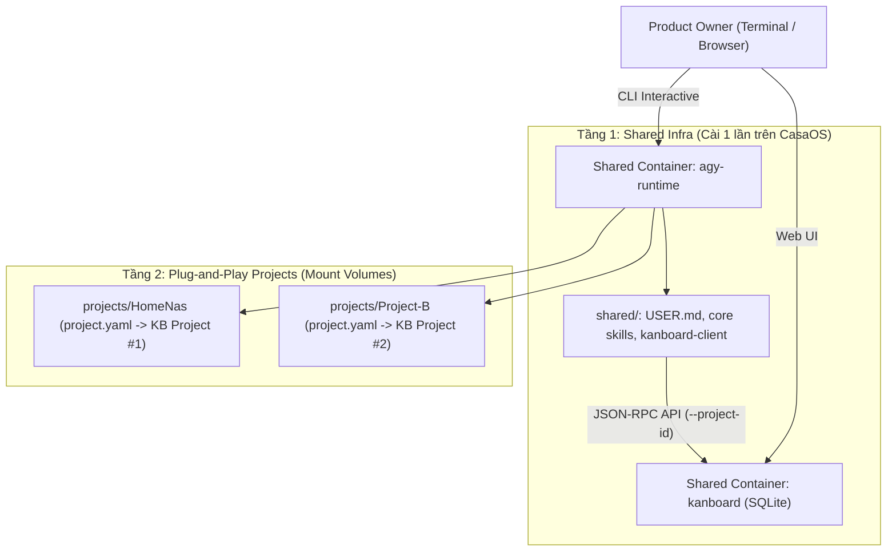

# 04. Information Architecture & Multi-Project Topology

## 1. Kiến trúc 2 Tầng: Shared Platform Infra vs. Project Workspaces

Hệ thống tách biệt rõ **Hạ tầng dùng chung (Platform)** và **Không gian từng dự án (Projects)** để tái sử dụng 100% Docker & Kanboard khi mở rộng thêm dự án mới.



## 2. Cấu trúc Thư mục Triển khai trên CasaOS / Debian

```text
/DATA/AppData/agy-platform/            # TẦNG 1: SHARED INFRA (Dùng chung mọi Project)
├── docker-compose.yml                 # 1 container agy-runtime + 1 container kanboard
├── Dockerfile.agy                     # Image Debian cài sẵn agy CLI & runtime tools
├── .env                               # KANBOARD_URL, KANBOARD_API_KEY
├── data/
│   └── kanboard/                      # SQLite DB chung cho tất cả Kanboard Projects
├── shared/                            # Tài nguyên lõi dùng chung
│   ├── memory/USER.md                 # Tầng 1 Memory: Hồ sơ & quy tắc chung của PO (≤300 tokens)
│   ├── skills/                        # Core AGY Skills (kanboard-ops, hermes-learning-loop)
│   └── tools/kanboard-client/         # Wrapper JSON-RPC nhận động --project-id
└── projects/                          # TẦNG 2: CÁC DỰ ÁN ĐỘC LẬP (Mỗi folder = 1 Git Repo)
    ├── HomeNas/                       # Dự án 1 (MVP hiện tại)
    │   ├── project.yaml               # Khai báo: kanboard_project_id, danh sách Sub-Chats
    │   ├── docs/                      # Tài liệu thiết kế dự án
    │   ├── memory/                    # Tầng 2 Memory riêng của HomeNas
    │   │   ├── dept-nas-ops/MEMORY.md
    │   │   ├── dept-media/MEMORY.md
    │   │   └── dept-dev/MEMORY.md
    │   ├── skills/                    # Tầng 3 AGY Skills riêng của HomeNas
    │   │   ├── director/
    │   │   ├── dept-nas-ops/
    │   │   ├── dept-media/
    │   │   └── dept-dev/
    │   └── tools/                     # Tools đặc thù (nas-inspector, media-inspector)
    └── <NewProject>/                  # Dự án 2, 3... (Tự plug-in không cần sửa Infra)
        ├── project.yaml               # kanboard_project_id: 2, phòng ban riêng
        ├── memory/
        ├── skills/
        └── src/
```

## 3. Cơ chế Mở rộng Project mới (Zero-Infra Duplication)
Để thêm một dự án mới sử dụng chung hạ tầng hiện có:
1. Tạo 1 Project mới trên Web UI Kanboard (ghi nhận `project_id`).
2. Tạo thư mục (hoặc clone repo) vào `/DATA/AppData/agy-platform/projects/<NewProject>/`.
3. Tạo file `project.yaml` khai báo `kanboard_project_id` và các phòng ban/skills cần dùng.
4. Khởi chạy `agy` trong thư mục dự án mới → tự động kế thừa `USER.md`, `kanboard-client` và Docker runtime.

## 4. Cấu trúc Bảng Kanboard (Sitemap)
- **Cấp Project:** `1 Kanboard Project = 1 Dự án thực tế` (VD: Project #1 = `HomeNas Operations`).
- **Swimlanes (Trong dự án `HomeNas`):** `Director / General`, `NAS Ops`, `Media & Download`, `Dev Studio`.
- **Columns chuẩn:** `Backlog` → `Ready` → `In Progress` → `Waiting Review` → `Done`.
- **Schema Thẻ Task (tối ưu token):**
  - **Title:** `[DEPT] Hành động ngắn gọn`
  - **Description:** Mục tiêu (1–2 dòng) + Phạm vi + Chế độ (`Fire-and-Forget` | `Interactive`).
  - **Comments:** Tóm tắt kết quả (≤ 5 dòng) + Bài học mới (nếu có).
  - **Tags:** `fire-and-forget`, `needs-approval`, `blocked`, `skill-proposal`.
