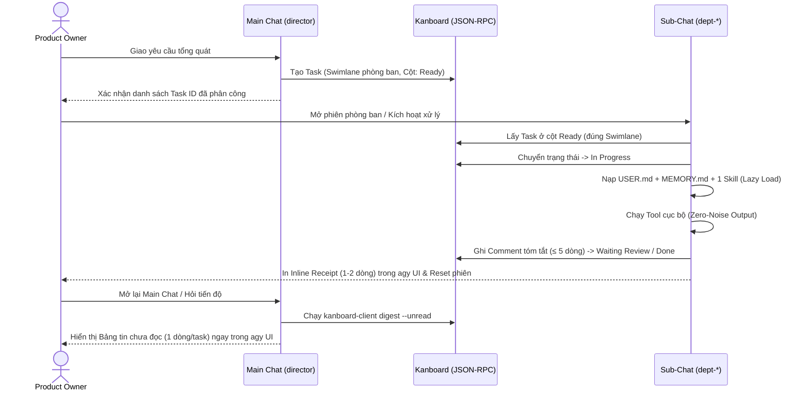
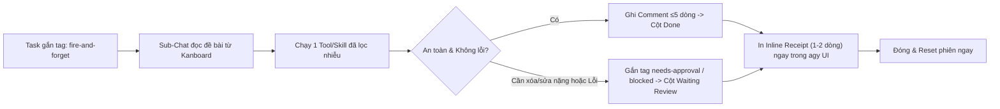
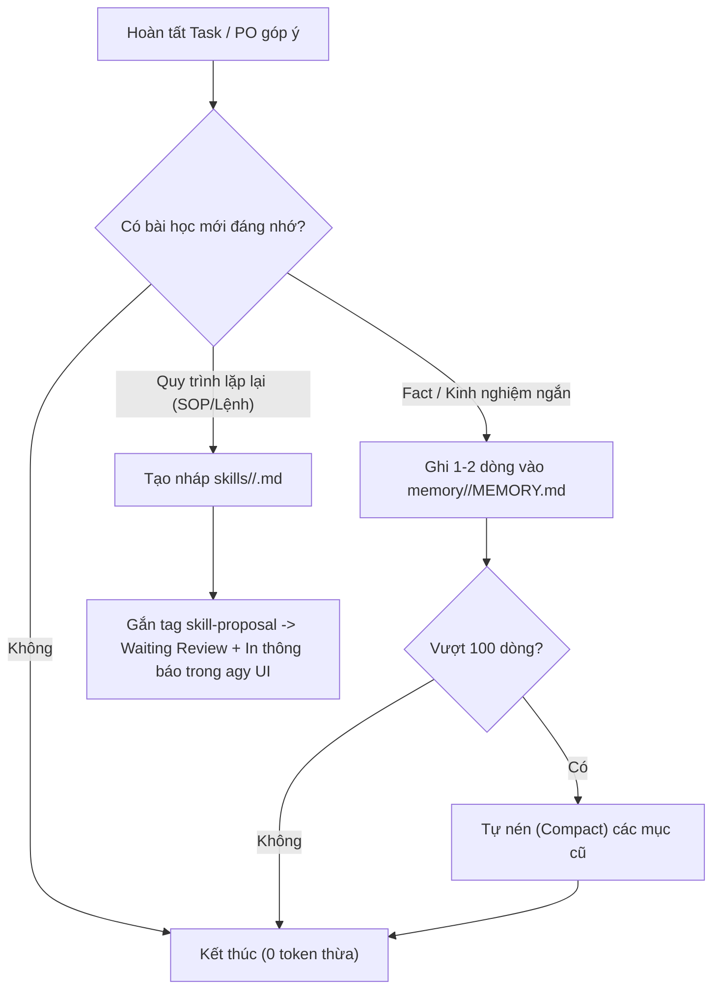

# 05. User Flows & Inter-Session Communication

## 1. Flow 1: Điều phối Tác vụ (Main Chat ↔ Kanboard ↔ Sub-Chat)

Kanboard đóng vai trò **Message Bus & Single Source of Truth**, giúp Main Chat và Sub-Chats giao tiếp bất đồng bộ, cô lập hoàn toàn context và tuân thủ 100% ToS Antigravity.

## 2. Flow 2: Chế độ Fire-and-Forget (Kèm Thông báo tại `agy` UI)

Áp dụng cho tác vụ độc lập, không cần tương tác nhiều lượt (VD: kiểm tra SMART ổ cứng, xem hàng đợi tải, kiểm tra dung lượng đĩa):

### Quy chuẩn Thông báo trong `agy` UI (Không cần chuyển sang Kanboard)
1. **Inline Compact Receipt (Tức thời tại Sub-Chat):** Luôn in 1–2 dòng tóm tắt trước khi kết thúc phiên theo mẫu:
   - `[✅ DONE | #<id> | <dept>] <Tóm tắt ngắn 1 dòng>`
   - `[⚠️ REVIEW | #<id> | <dept>] <Lý do cần PO duyệt> (tag: needs-approval)`
   - `[❌ BLOCKED | #<id> | <dept>] <Lỗi ngắn gọn> (tag: blocked)`
2. **Unread Digest (Tổng hợp tại Main Chat `director`):** Khi PO mở lại `director`, tự động (hoặc theo lệnh) gọi `kanboard-client digest --unread` đối chiếu mốc `.state/last_digest_ts` để chỉ hiển thị các task mới hoàn thành/cần duyệt chưa xem, mỗi task đúng 1 dòng.

## 3. Flow 3: Vòng lặp Tự học (Hermes Closed Learning Loop)

Chạy gọn ở bước cuối mỗi Task (chỉ kích hoạt khi có tri thức mới hoặc PO góp ý sửa lỗi):

## 4. Quy tắc Đồng bộ & Ngăn xung đột
- **Chủ sở hữu thẻ:** Tại một thời điểm, chỉ 1 Sub-Chat xử lý thẻ ở cột `In Progress`.
- **Chốt chặn phá hủy (Human-in-the-Loop):** Mọi lệnh xóa file, dừng/xóa container Docker hoặc sửa cấu hình mạng đều **không được tự chạy ở chế độ Fire-and-Forget**; bắt buộc đẩy về `Waiting Review` kèm tag `needs-approval` và in cảnh báo `[⚠️ REVIEW]` ngay trong `agy` UI.
