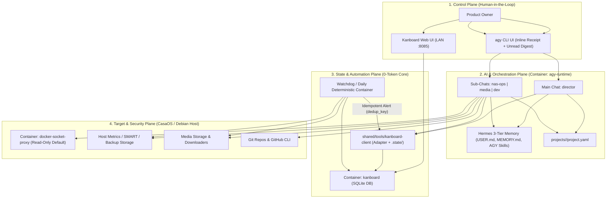

# 07. System Design Blueprint (Master Architecture)

Tài liệu này là bản thiết kế tổng thể cấp hệ thống cho **HomeNas (Smart Home AI Orchestrator)** trên nền **CasaOS / Debian Docker**, kết nối toàn bộ hạ tầng dùng chung (Platform), không gian đa dự án (Multi-Project), cơ chế tự động hóa 0-token và vòng lặp tự học Hermes.

## 1. Kiến trúc 4 Lớp (4-Plane Architecture)

## 2. Ranh giới Vận hành & Tuân thủ ToS (Execution Boundaries)

| Luồng xử lý | Tác nhân kích hoạt | Tiêu thụ Token | Cơ chế thực thi | Mức độ an toàn |
| :--- | :--- | :--- | :--- | :--- |
| **Giám sát, Telegram & Backup định kỳ** | Watchdog Container (Docker/CasaOS) | **0 token** | Bash/Python thuần + `kanboard-client` | Silent when healthy; alert qua `dedup_key` |
| **Điều phối & Báo cáo tổng** | PO mở `director` | Rất thấp | `kb digest --unread`, tạo thẻ gọn ≤ 3 dòng | Chỉ đọc tóm tắt, không chạy lệnh hệ thống |
| **Tác vụ độc lập (Read/Check)** | PO kích hoạt Sub-Chat | Thấp | **Fire-and-Forget** + Inline Receipt + Reset phiên | Chỉ thao tác không phá hủy |
| **Tác vụ có rủi ro / Sửa hệ thống** | PO duyệt thẻ | Trung bình | **Interactive** + thẻ tag `needs-approval` | Bắt buộc Human-in-the-Loop |
| **Cập nhật tri thức (Hermes)** | Cuối mỗi Task | Rất thấp | Facts → `MEMORY.md`; SOP → `skill-proposal` | Skill thực thi bắt buộc PO duyệt |

## 3. Hợp đồng Liên kết giữa các Thành phần (Integration Contracts)

1. **Multi-Project Plug-in:** `agy-runtime` đọc `project.yaml` tại thư mục dự án hiện hành để tự động ánh xạ `kanboard_project_id`, `swimlane`, `memory_file` và `allowed_tools`.
2. **Idempotent Alerting (Watchdog → Kanboard):** Mọi Daily Script phải đính kèm mã `[DEDUP:<script>:<target>]` trong tiêu đề/mô tả; `kanboard-client` kiểm tra thẻ mở trùng khớp để **cập nhật comment** thay vì tạo thẻ rác lặp lại.
3. **Zero-Noise Notification Loop (Kanboard → `agy` UI):**
   - Sub-Chat kết thúc task → ghi Comment ≤ 5 dòng + in **Inline Compact Receipt** (1–2 dòng).
   - Main Chat khởi động → gọi `kb digest --unread` dựa trên `.state/last_digest_ts` để in bảng tin mới chưa đọc ngay trong terminal.
4. **Stateless Session Discipline:** Mọi trạng thái công việc nằm ở **Kanboard**, mọi tri thức nằm ở **`memory/` & `skills/`** → Sub-Chat luôn có thể đóng/reset sau mỗi thẻ để giữ input token ở mức sàn.

## 4. Mô hình Bảo mật 4 Lớp (Defense-in-Depth)

- **Lớp 1 — Cô lập mạng:** `kanboard` chỉ mở port LAN nội bộ; `docker-socket-proxy` chỉ tồn tại trong bridge network `agy-net` (không expose port ra host).
- **Lớp 2 — Quyền tối thiểu (Least Privilege):** `docker-socket-proxy` mặc định chặn mọi lệnh `POST/DELETE/EXEC` đối với AI; mỗi Sub-Chat chỉ được khai báo đúng tập `allowed_tools` trong `project.yaml`.
- **Lớp 3 — Quản lý bí mật (Secrets):** `KANBOARD_API_TOKEN`, `TELEGRAM_BOT_TOKEN` lưu trong `.env` (chmod `600`, git-ignored). OAuth của `agy` chỉ nằm trong volume nội bộ của `agy-runtime`, tuyệt đối không chia sẻ cho tool ngoài.
- **Lớp 4 — Chống nhiễm độc bộ nhớ (Memory Poisoning Guard):** Toàn bộ `memory/` và `skills/` được quản lý bằng Git; mọi đề xuất Skill mới có lệnh thực thi đều phải đi qua cột `Waiting Review` (`skill-proposal`).

## 5. Bản đồ Tài liệu Chi tiết theo Phòng ban (Department Blueprints)
- **Phòng 1 — NAS Ops (`dept-nas-ops`):** `docs/departments/01-dept-nas-ops.md` *(Bước 3.2b)*
- **Phòng 2 — Media & Download (`dept-media`):** `docs/departments/02-dept-media.md` *(Bước 3.2c)*
- **Phòng 3 — Dev Studio (`dept-dev`):** `docs/departments/03-dept-dev.md` *(Bước 3.2d)*
